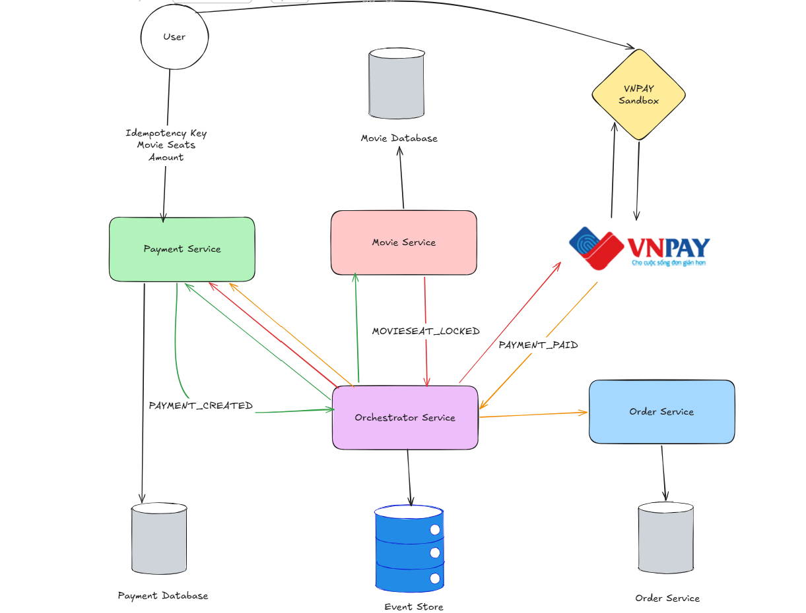
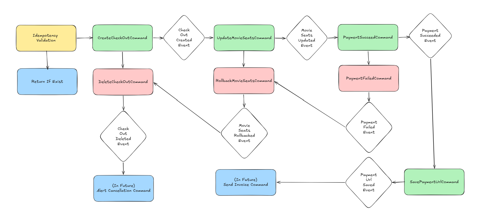

# payment-system
Integrate VNPay to demonstrate a movie ticket purchasing flow, including movie selection, seat reservation, payment processing, and ticket confirmation. Apply the Saga Pattern to coordinate distributed transactions across services and ensure data consistency through compensating actions when a step fails. Implement idempotency to prevent duplicate payment requests, duplicate ticket bookings, and inconsistent transaction states when requests are retried or payment callbacks are received multiple times.

## Video Demo

## Architecture

## Saga Pattern Orchestration Flow

## Key Highlight

- **Distributed Transaction Management:** Implemented distributed transaction workflows using the Saga Pattern and Axon Framework, ensuring reliable transaction coordination across microservices.
- **Idempotency and Reliability:** Implemented idempotency mechanisms to prevent duplicate processing and maintain consistent transaction handling across services.
- **Microservices Architecture & Payment Integration:** Designed and developed a Spring Boot-based microservices platform covering payment processing, order management, movie management, and VNPay payment gateway integration.