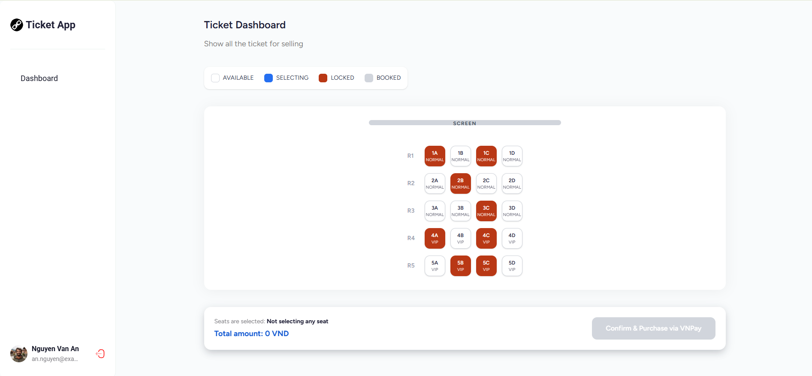

# payment-system
Integrate VNPay to demonstrate a movie ticket purchasing flow, including movie selection, seat reservation, payment processing, and ticket confirmation. Apply the Saga Pattern to coordinate distributed transactions across services and ensure data consistency through compensating actions when a step fails. Implement idempotency to prevent duplicate payment requests, duplicate ticket bookings, and inconsistent transaction states when requests are retried or payment callbacks are received multiple times.

## Video Demo

## Architecture

